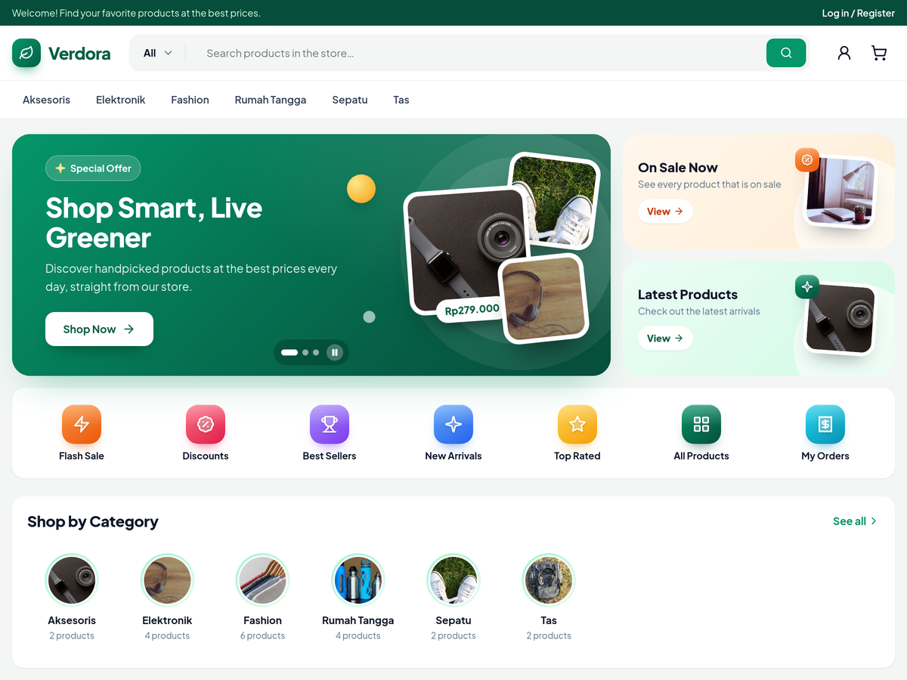

# Verdora

Tema WooCommerce bergaya marketplace (ala Tokopedia/Shopee) dengan identitas warna **hijau emerald**. Ringan, responsif, mobile-first, dan aksesibel, tanpa page builder. Disiapkan untuk direktori tema WordPress.org: teks sumber berbahasa Inggris dengan terjemahan Indonesia bawaan.

Fitur di luar urusan tampilan (tombol WhatsApp, meta SEO, importer data contoh) ada di plugin pendamping opsional **Verdora Companion** di folder [`companion/`](companion/verdora-companion).




---

## Daftar Isi

- [Fitur](#fitur)
- [Kebutuhan Sistem](#kebutuhan-sistem)
- [Instalasi](#instalasi)
- [Plugin Pendamping: Verdora Companion](#plugin-pendamping-verdora-companion)
- [Bahasa & Terjemahan](#bahasa--terjemahan)
- [Mengatur Menu](#mengatur-menu)
- [Pengaturan Tema (Customizer)](#pengaturan-tema-customizer)
- [Struktur Folder](#struktur-folder)
- [Untuk Developer](#untuk-developer)
- [Keamanan, Performa & SEO](#keamanan-performa--seo)
- [Membuat ZIP & Submit ke WordPress.org](#membuat-zip--submit-ke-wordpressorg)
- [Kredit](#kredit)
- [Lisensi](#lisensi)

---

## Fitur

**Tampilan marketplace**
- Header dengan pencarian produk + dropdown kategori yang bisa diakses keyboard dan pembaca layar
- Navbar dengan **dropdown submenu** (hover, fokus keyboard, Esc, dan dukungan layar sentuh)
- **Slider banner** ala marketplace: slide utama, slide gambar unggahan (desktop + HP), serta slide otomatis "Diskon hingga X%" dan "Koleksi Terbaru" yang memakai foto produk toko. Ada 2 banner samping.
- **Menu Cepat**: deretan ikon berwarna (Flash Sale, Diskon, Terlaris, Produk Baru, Rating Terbaik, Semua Produk, Pesanan Saya; plus Chat Penjual bila plugin pendamping aktif)
- Kategori tampil sebagai foto produk dalam lingkaran atau ikon berwarna
- Section beranda: **Kategori**, **Flash Sale** (dengan hitung mundur & bar stok), **Produk Pilihan**, dan **Rekomendasi** — semuanya bisa diatur dan diurutkan ulang
- Kartu produk dengan badge diskon (persen/teks), rating, jumlah terjual, dan tombol tambah ke keranjang

**Halaman WooCommerce**
- Shop & arsip kategori dengan sidebar filter (kategori, rentang harga, produk diskon)
- Detail produk dengan galeri (zoom, lightbox, slider), jumlah terjual, dan poin info
- Cart & Checkout — mendukung versi klasik maupun **block** WooCommerce
- Jumlah keranjang di header ter-update otomatis (cart fragments)

**Mobile**
- Navigasi bawah ala aplikasi (Beranda, Kategori, Keranjang, Akun)
- Menu samping (drawer) dengan menu utama, kategori, dan menu informasi
- Tombol kembali ke atas

**Lainnya**
- **128 kontrol pengaturan** di Customizer dalam 9 bagian, dengan pratinjau langsung
- 4 lokasi menu
- Siap diterjemahkan: teks sumber bahasa Inggris, terjemahan Indonesia sudah disertakan
- Warna utama otomatis diturunkan menjadi 6 gradasi warna
- Ikon SVG inline — tanpa icon font

---

## Kebutuhan Sistem

| Komponen | Versi minimum | Diuji sampai |
|---|---|---|
| WordPress | 6.5 | 7.1 |
| WooCommerce | 8.0 | 11.3 |
| PHP | 7.4 | 8.5 |

Tema tetap berfungsi tanpa WooCommerce (sebagai tema blog), tetapi fitur toko baru aktif setelah WooCommerce terpasang.

---

## Instalasi

### Lewat dashboard WordPress

1. Unduh `verdora-x.y.z.zip` dari halaman **Releases**, atau buat sendiri dengan `bash bin/build-zip.sh` (lihat [Membuat ZIP](#membuat-zip--submit-ke-wordpressorg)).
2. Buka **Appearance → Themes → Add New → Upload Theme**, pilih file zip, lalu **Install Now** dan **Activate**.

### Lewat Git

```bash
cd wp-content/themes
git clone https://github.com/anggiyawan/verdora-woocommerce-theme.git verdora
```

Lalu aktifkan di **Appearance → Themes**.

### Setelah aktivasi

1. Pasang dan aktifkan plugin **WooCommerce** bila belum.
2. Jalankan wizard WooCommerce agar halaman Shop, Cart, Checkout, dan My Account terbentuk.
3. (Opsional) Pasang plugin **Verdora Companion** untuk WhatsApp, meta SEO, dan data contoh. Lihat bagian berikut.
4. Atur tampilan di **Appearance → Verdora Settings**.
5. Untuk toko berbahasa Indonesia: ubah **Settings → General → Site Language** ke **Bahasa Indonesia**. Tema, plugin pendamping, dan WooCommerce akan tampil dalam bahasa Indonesia.
6. Aktifkan minimal satu metode pembayaran di **WooCommerce → Settings → Payments**.

---

## Plugin Pendamping: Verdora Companion

Aturan WordPress.org melarang tema membawa fitur "wilayah plugin". Karena itu fitur berikut dipisah ke plugin [`companion/verdora-companion`](companion/verdora-companion), yang bisa dipasang terpisah:

| Fitur | Letak pengaturan |
|---|---|
| **WhatsApp**: tombol chat melayang, tombol "Tanya via WhatsApp" di halaman produk (pesan otomatis berisi nama & link produk), dan ikon "Chat Penjual" di Menu Cepat | Customize → Verdora Settings → WhatsApp |
| **Meta SEO**: meta description & Open Graph (otomatis nonaktif bila Yoast, Rank Math, AIOSEO, SEOPress, atau The SEO Framework aktif) | Customize → Verdora Settings → SEO Meta Tags |
| **Data contoh**: impor 10 produk lengkap dengan 19 foto CC0, impor ulang aman, dan hapus bersih hanya data contoh | Appearance → Verdora Demo Content |

**Memasang:** unggah `dist/verdora-companion-x.y.z.zip` lewat **Plugins → Add New → Upload Plugin**, atau salin folder `companion/verdora-companion` ke `wp-content/plugins/`.

Pengaturan disimpan dengan nama yang sama seperti versi tema sebelumnya (`verdora_wa_number`, dst.), jadi nilai lama tetap terbaca. Nomor WhatsApp boleh ditulis dengan format apa pun (`0812…`, `+62 812…`, `62812…`).

---

## Bahasa & Terjemahan

- Teks sumber tema dan plugin berbahasa **Inggris**, sesuai standar translate.wordpress.org.
- Terjemahan **Indonesia** sudah disertakan: `languages/id_ID.po/.mo` (tema) dan `companion/verdora-companion/languages/verdora-companion-id_ID.po/.mo` (plugin).
- Template untuk bahasa lain: `languages/verdora.pot` dan `verdora-companion.pot`. Terjemahkan dengan Poedit atau Loco Translate.
- Teks bawaan Customizer (judul banner, teks bar atas, dan sebagainya) ikut bahasa situs selama belum kamu ubah sendiri.

---

## Mengatur Menu

Buka **Appearance → Menus**, buat menu, lalu centang lokasinya.

| Lokasi | Tampil di | Jika kosong |
|---|---|---|
| **Navigasi Utama** | Navbar di bawah pencarian + menu samping HP | Kategori produk otomatis (beserta subkategori sebagai dropdown) |
| **Bar Atas** | Kanan bar paling atas (desktop) + bagian "Informasi" di menu samping HP | Tidak ditampilkan |
| **Footer: Kolom Kategori** | Kolom kategori di footer | 6 kategori produk otomatis |
| **Footer: Kolom Bantuan** | Kolom bantuan di footer | Link Shop, Keranjang, Akun, dan Kebijakan Privasi |

**Membuat dropdown:** di layar menu, geser item sedikit ke kanan di bawah item induknya sehingga menjadi *sub item*. Navigasi Utama mendukung 2 tingkat.

---

## Pengaturan Tema (Customizer)

Buka **Appearance → Verdora Settings** (atau **Appearance → Customize → Verdora Settings**). Pengaturan yang tidak relevan otomatis disembunyikan; misalnya pengaturan Flash Sale hanya muncul bila Flash Sale diaktifkan.

| Bagian | Isi pengaturan |
|---|---|
| **Tampilan Umum** | Warna utama, aksen, diskon, dan latar; jenis huruf (Plus Jakarta Sans, Poppins, Inter, Nunito, DM Sans, atau huruf sistem); bentuk sudut; lebar konten; animasi |
| **Header** | Teks bar atas, link Masuk/Daftar, header tetap saat scroll, ikon akun, teks pencarian, dropdown kategori, baris navigasi |
| **Beranda: Banner** | Geser otomatis (mati/5–10 detik), slide otomatis Diskon & Terbaru, slide utama (label, judul, subjudul, tombol, gambar, ornamen, gradien, gambar latar, warna teks), tinggi banner, 4 slide gambar (desktop, HP, link), 2 banner samping (teks atau gambar) |
| **Beranda: Section Produk** | Menu Cepat; gaya gambar kategori (foto/ikon). Untuk Kategori, Flash Sale, Produk Pilihan, dan Rekomendasi: tampil/sembunyi, judul, jumlah, dan urutan. Flash Sale punya tanggal berakhir; Rekomendasi punya urutan produk dan teks tombol |
| **Toko & Kartu Produk** | Produk per halaman, jumlah kolom (Shop, beranda, HP), sidebar filter, rasio & cara foto mengisi kotak, label kategori, rating, tombol keranjang, gaya badge diskon |
| **Halaman Detail Produk** | Jumlah terjual, SKU/kategori/tag, galeri tetap saat scroll, poin info, produk terkait |
| **Media Sosial** | Link Instagram, Facebook, TikTok, YouTube, X |
| **Footer & Kontak** | Deskripsi toko, kolom kategori & judulnya, judul kolom bantuan, telepon, email, alamat, teks hak cipta (`{year}` dan `{site}` diganti otomatis; `{tahun}`/`{situs}` lama tetap didukung), catatan kanan bawah |
| **Tampilan Mobile** | Navigasi bawah ala aplikasi, tombol kembali ke atas |

Bagian **WhatsApp** dan **SEO Meta Tags** muncul di panel yang sama bila plugin pendamping aktif.

---

## Struktur Folder

```
verdora/
├── style.css                 # Header tema (metadata saja)
├── readme.txt                # Readme WordPress.org (lisensi & sumber aset)
├── functions.php             # Konstanta & pemuatan modul
├── screenshot.png
├── header.php / footer.php
├── front-page.php            # Beranda: section diurutkan sesuai pengaturan
├── index.php, single.php, page.php, archive.php,
│   search.php, 404.php, sidebar.php, comments.php
├── searchform.php            # Pencarian toko (header) & pencarian biasa, via get_search_form()
├── inc/
│   ├── setup.php             # Theme support, menu, sidebar, body class
│   ├── icons.php             # Ikon SVG inline
│   ├── template-tags.php     # Fungsi bantu template
│   ├── customizer-options.php# Skema semua pengaturan
│   ├── customizer.php        # Registrasi Customizer & sanitasi
│   ├── customizer-heading-control.php
│   ├── dynamic-css.php       # CSS variable dari pengaturan + meta theme-color
│   ├── enqueue.php           # CSS, JS, font
│   ├── woocommerce.php       # Integrasi WooCommerce (hook, bukan override template)
│   └── home.php              # Data beranda: slide banner, kolase produk, menu cepat
├── template-parts/
│   ├── header/               # Menu samping (drawer)
│   ├── home/                 # Slider banner, slide, menu cepat, kategori, flash sale, pilihan, rekomendasi
│   ├── content-card.php
│   └── content-none.php
├── assets/
│   ├── css/main.css          # Tampilan umum
│   ├── css/woocommerce.css   # Tampilan toko
│   ├── css/editor-style.css  # Tampilan di editor blok
│   └── js/main.js            # JavaScript vanilla
├── languages/                # verdora.pot + terjemahan Indonesia (id_ID)
├── bin/build-zip.sh          # Membuat ZIP tema & plugin (tidak ikut ZIP)
└── companion/
    └── verdora-companion/    # Plugin pendamping (tidak ikut ZIP tema)
        ├── includes/         # whatsapp.php, seo.php, demo-import.php
        ├── demo/             # 10 produk contoh, 19 foto CC0, credits.txt
        └── languages/
```

---

## Untuk Developer

### Prinsip

- **Tanpa override template WooCommerce.** Semua penyesuaian lewat hook, sehingga tema tidak perlu diperbarui setiap kali WooCommerce merilis versi baru.
- **CSS bawaan WooCommerce dinonaktifkan** dan diganti `woocommerce.css` milik tema.
- **Modular.** Setiap tanggung jawab punya file sendiri di `inc/`. Fitur wilayah plugin ada di plugin pendamping.
- **Berbasis skema.** Semua pengaturan didefinisikan sekali di `inc/customizer-options.php`. Kontrol, nilai default, sanitasi, dan aturan tampil/sembunyi dibuat otomatis dari skema itu.

### Membaca pengaturan

```php
$judul = verdora_option( 'hero_title' ); // = get_theme_mod( 'verdora_hero_title', <default dari skema> )
```

### Menambah pengaturan baru

Tambahkan entri ke array `fields` pada bagian yang sesuai di `inc/customizer-options.php`:

```php
'contoh_teks' => array(
	'type'    => 'text',
	'label'   => __( 'Example text', 'verdora' ), // teks sumber dalam bahasa Inggris
	'default' => '',
	'show_if' => array( 'hero_show', true ), // opsional: tampil hanya bila opsi lain bernilai tertentu
),
```

Lalu panggil `verdora_option( 'contoh_teks' )` di template. Setelah menambah teks baru, perbarui `languages/verdora.pot` dan terjemahan `id_ID.po`.

### Mengubah Menu Cepat

```php
add_filter( 'verdora_quick_links', function ( $links ) {
	unset( $links['orders'] );
	$links['voucher'] = array(
		'label' => 'Voucher',
		'url'   => home_url( '/voucher/' ),
		'icon'  => 'gift',   // nama ikon dari inc/icons.php
		'color' => 'pink',   // green, blue, pink, orange, violet, cyan, rose, amber, lime, wa, brand
	);
	return $links;
} );
```

### Kustomisasi lewat CSS

Seluruh warna, ukuran, dan tata letak memakai CSS custom property, sehingga mudah diubah dari child theme atau **Additional CSS**:

```css
:root {
	--vd-primary: #047857;
	--vd-radius: 6px;
	--vd-cols-shop: 5;
}
```

Variabel utama: `--vd-primary` (+ `-50` s.d. `-800`), `--vd-accent`, `--vd-danger`, `--vd-bg`, `--vd-surface`, `--vd-text`, `--vd-muted`, `--vd-font`, `--vd-radius`, `--vd-container`, `--vd-cols-home`, `--vd-cols-shop`, `--vd-cols-mobile`, `--vd-card-ratio`, `--vd-hero-bg`, `--vd-hero-min-h`.

### Child theme

Buat folder `verdora-child` berisi `style.css`:

```css
/*
Theme Name: Verdora Child
Template:   verdora
*/
```

Fungsi tema dipasang lewat `add_action` / `add_filter`, jadi bisa dilepas dari child theme dengan `remove_action` lalu diganti versimu sendiri. Hook WooCommerce yang bergantung pada pengaturan dipasang pada hook `wp`, jadi lepaskan setelah hook tersebut berjalan.

---

## Keamanan, Performa & SEO

**Keamanan**
- Setiap output di-escape (`esc_html`, `esc_attr`, `esc_url`) dan setiap pengaturan Customizer disanitasi sesuai tipenya
- Aksi admin (di plugin pendamping) dilindungi nonce dan pemeriksaan hak akses
- Semua modul di `inc/` menolak akses langsung (`defined( 'ABSPATH' ) || exit`)
- Tema tidak menyimpan data apa pun selain pengaturan Customizer (theme mods); cache foto kategori memakai object cache

**Performa**
- Total CSS + JS sekitar 90 KB (belum diperkecil), tanpa framework CSS, dan JavaScript tema tidak bergantung pada jQuery
- JavaScript dimuat dengan `defer`
- Google Fonts tidak dimuat sama sekali bila memilih huruf sistem, dan memakai `preconnect` bila aktif
- Ikon SVG inline, tanpa request tambahan
- Animasi menghormati `prefers-reduced-motion` dan bisa dimatikan

**SEO & aksesibilitas**
- HTML semantik dengan landmark (`header`, `nav`, `main`, `footer`)
- `theme-color` mengikuti warna utama; meta description & Open Graph tersedia lewat plugin pendamping atau plugin SEO pilihanmu
- Mendukung navigasi keyboard penuh, link "skip to content", dan atribut ARIA pada dropdown, listbox, dan drawer

---

## Membuat ZIP & Submit ke WordPress.org

```bash
bash bin/build-zip.sh
```

Hasilnya ada di `dist/`:

- `verdora-1.0.0.zip`: tema untuk diunggah ke WordPress.org. Tanpa `.git`, `.gitattributes`, `bin/`, `dist/`, `companion/`, dan README.md.
- `verdora-companion-1.0.0.zip`: plugin pendamping, untuk dibagikan lewat GitHub Releases.

Sebelum submit:

1. Pasang `verdora-1.0.0.zip` di situs uji, lalu jalankan plugin **Theme Check** (Appearance → Theme Check). Jangan jalankan pada folder repo ini, karena `.git` dan `companion/` akan ikut dilaporkan.
2. Pastikan `Contributors:` di `readme.txt` berisi username WordPress.org kamu.
3. Unggah di [wordpress.org/themes/upload](https://wordpress.org/themes/upload/).

---

## Kredit

- Ikon: berbasis [Lucide](https://lucide.dev) — lisensi ISC
- Huruf: [Google Fonts](https://fonts.google.com) — lisensi SIL Open Font License
- Foto data contoh & screenshot: CC0 / Public Domain dari StockSnap, Rawpixel, dan WordPress Photo Directory melalui [Openverse](https://openverse.org). Rinciannya ada di [`readme.txt`](readme.txt) dan [`companion/verdora-companion/demo/credits.txt`](companion/verdora-companion/demo/credits.txt)

---

## Lisensi

Verdora dirilis di bawah lisensi [GNU General Public License v2 atau lebih baru](https://www.gnu.org/licenses/gpl-2.0.html), sama seperti WordPress.

Dibuat oleh **Priyana Anggiyawan**.
